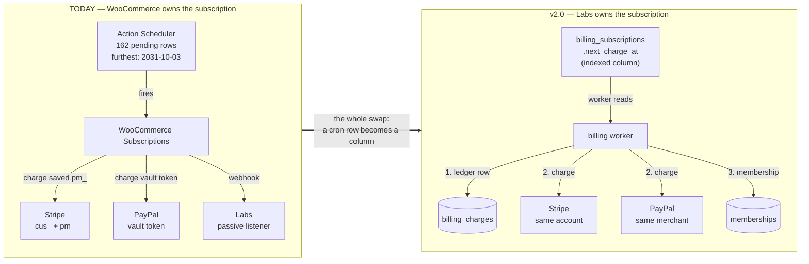
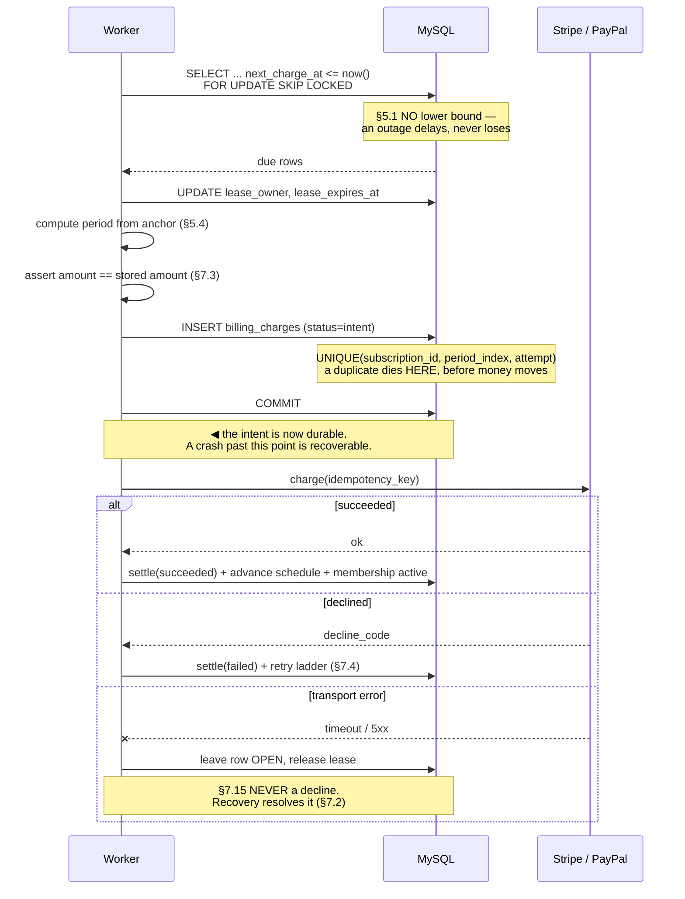
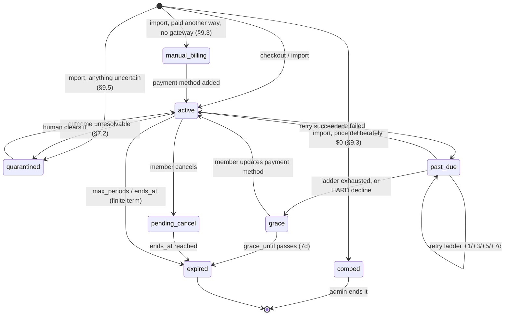
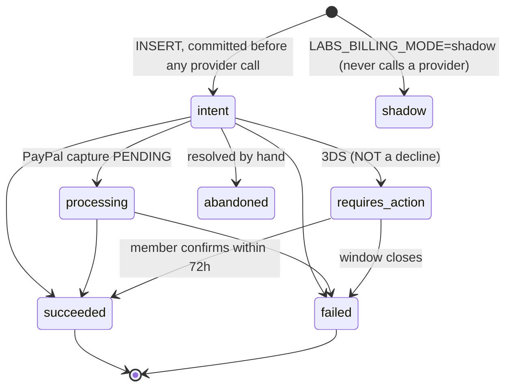
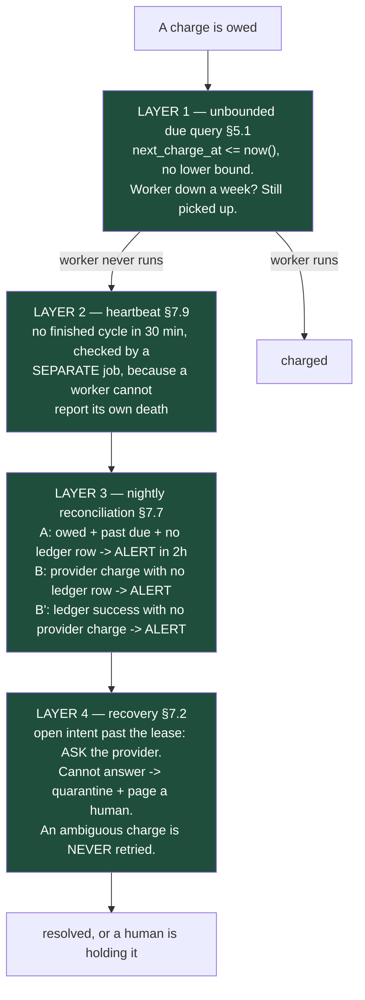
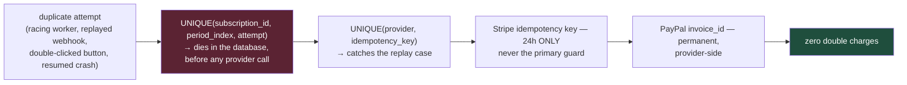
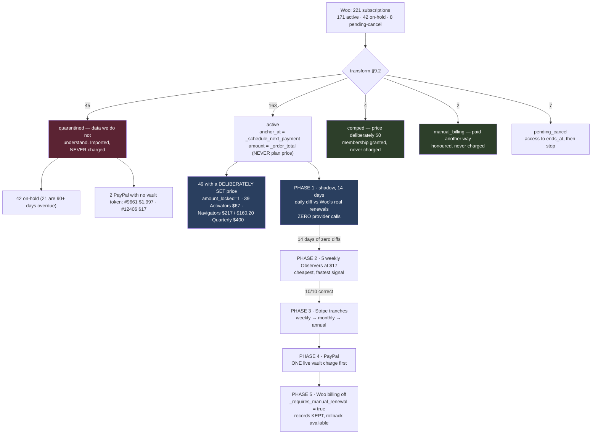

# Native Billing v2.0 — Diagrams

Companion to [SPEC-Native-Billing-v2.0.md](SPEC-Native-Billing-v2.0.md). Section
references point there.

---

## 1. Who owns what, before and after

**The providers never owned the subscription.** All nine Woo subscription products
have `_ppcp_enable_subscription_product = no`, and there are zero Stripe Billing
subscription objects. Both sides only ever held a reusable authorization.

---

## 2. The charge sequence — why the ledger is written first

---

## 3. Subscription state machine

`comped` and `manual_billing` are **deliberate** non-billing states, not faults. The worker's
due query selects `status IN ('active','past_due','grace')`, so neither can ever be charged —
structurally, not by a flag check inside the loop. Proven by test section 10b.

Access follows `memberships.status`, which billing writes only through
`upsert_membership`. `grace` is already treated as entitled by the existing
`derive_role`, so a member keeps access for the whole 7 days.

---

## 4. Charge ledger — a one-way path

`succeeded`, `failed` and `abandoned` are terminal: a late-arriving webhook cannot
resurrect a settled charge. Enforced in `ledger.settle`, proven by test
*"a settled charge cannot be resurrected by a late event"*.

---

## 5. How a payment cannot slip — four independent layers

And in the other direction — a charge cannot happen **twice**:

The two racing cases are blocked by **different** keys — the concurrent-worker case
by the period key, the replay case by the idempotency key. Both are needed; neither
covers the other. Proven by tests 3 and 5.

---

## 6. Migration and cutover

Each subscription goes live by flipping **its own** Woo `_requires_manual_renewal`
to `true` — per-subscription, reversible, and every Woo record intact. Deleting
Action Scheduler rows would be irreversible and is forbidden (§7.18).
